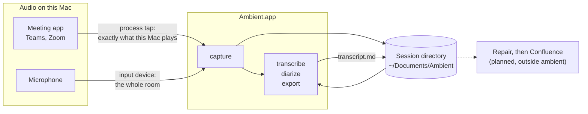
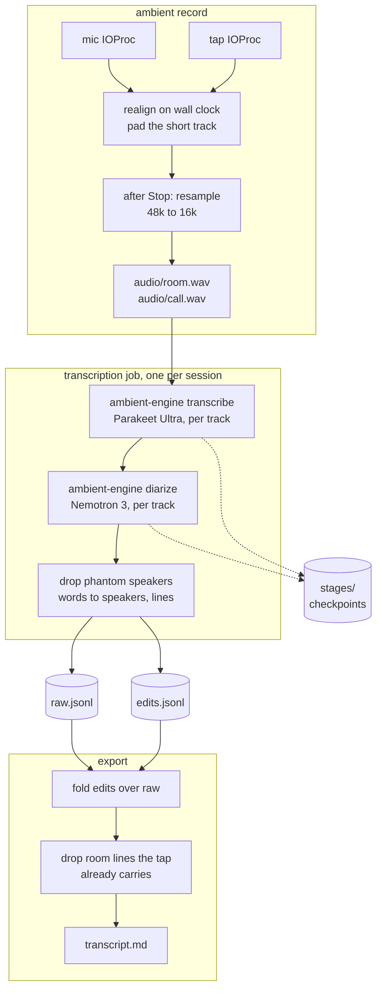

# How it fits together

Start with the [contributor guide](https://github.com/jasonm4130-labs/ambient/blob/main/CONTRIBUTING.md)
for setup and checks. Use [release preparation](releasing.md) for a distributable build.

Ambient is one signed macOS app bundle. It records two audio tracks, transcribes
them on this machine, works out who spoke, and writes a markdown file. Nothing
leaves the Mac until you hand the markdown to something else.

Everything below is a link into the chapter that explains it, and most of those
chapters exist because the obvious approach did not work. The decisions are
recorded separately under [Decisions](../adr/README.md).

## What talks to what

The two arrows into `capture` are the whole design in miniature. The tap hears
only what this Mac renders, so it is the clean copy of the far side and it
cannot pick up the desk next to you. The microphone hears everything in the
room, which is what makes it useful and what makes it the sensitive one. They
are kept apart all the way to the transcript, and merged only at export — see
[capture](capture.md) and [two tracks, two clocks](two-tracks.md).

The dashed arrow out of the session directory is the one thing in this diagram
that is not built. Nothing in `Cargo.toml` is an HTTP client or an Anthropic
SDK, and `src/` mentions neither Anthropic nor Confluence. So the claim is two
sources in and one session directory out: everything past `transcript.md` is
something you do yourself. The dash means something else in the diagram below,
where it marks a checkpoint written along the way.

## What happens to the audio

Nothing is transcribed while recording. After Stop, the app's queue runs one
job at a time, and each model stage runs in its own `ambient-engine` process.
The dotted arrows are the checkpoints: a job that dies resumes at the first
stage it had not finished. Diarize is skipped when the `diarize` setting is off.
See [transcription](asr.md) and [speaker separation](diarization.md).

The job writes `raw.jsonl` and the speaker labels in `edits.jsonl` once, and
`transcript.md` last. After that, a name you type or a revert is a line
appended to `edits.jsonl`, and `transcript.md` is recomputed from the two. A
re-run copies all three to `previous/` before it writes new ones. See
[sessions and the edit layer](sessions.md).

## Where the hard parts are

| Chapter | The thing that was not obvious |
| --- | --- |
| [Capture](capture.md) | A terminal-launched binary gets a working tap that returns silence, with no error and no prompt |
| [Two tracks, two clocks](two-tracks.md) | A process tap gates its aggregate's clock, so a mic sharing it is starved by a quiet room |
| [Transcription](asr.md) | A job can die at any stage, so each stage's output is a checkpoint keyed to the audio and the model |
| [Speaker separation](diarization.md) | The speaker model sometimes splits one voice in two, so a speaker with under 5 s of speech is dropped |
| [Sessions](sessions.md) | The microphone transcribes the far side badly, so a naive merge reads as broken |
| [Settings and the UI](settings-and-ui.md) | Compiling proves the page says the right thing, not that it does anything |
| [What is kept](../using/what-is-kept.md) | A transcript file exists even when nothing was recognised, so it cannot gate a deletion |
